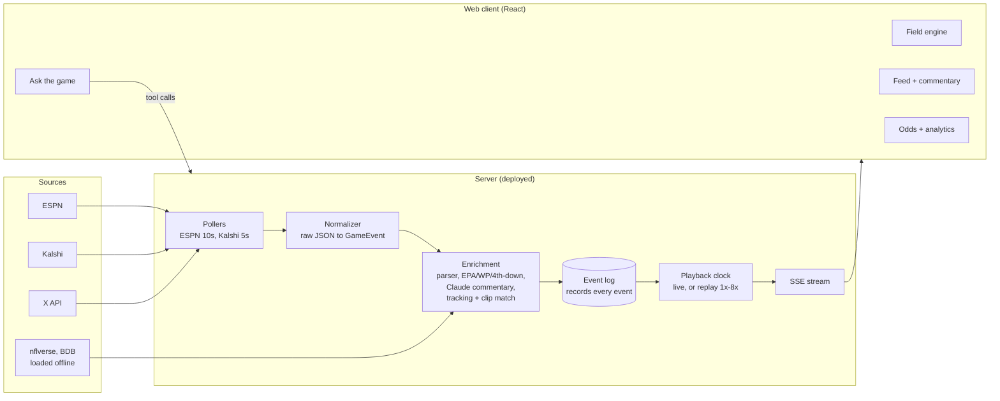

# Gridcast PRD: Live NFL Game Reconstruction

Oct 24, 2026 · Jason · Working name, hackathon build

## Overview

Gridcast turns an NFL game's live play-by-play feed into an animated 2D broadcast with AI announcers, live odds and analytics, so you can follow and understand a game without the video. We demo it live on Steelers vs Saints (Paris, kickoff 9:30 AM ET) during judging, plus a polished replay of a past game.

**Problem.** Play-by-play text and box scores are the only free live game data, and they're hard to read. GameCast-style drive charts show where the ball went, not what happened or why it mattered. Casual fans and people who can't watch (at work, abroad, no NFL Network) get a wall of text.

**Vision.** A second-screen broadcast built from data: every play animated on a field, called by AI announcers, framed by what the betting market and win-probability models think, with real clips on the big moments.

**Goals**

- Animate every play within 15 s of it appearing in the feed, with 22 players, ball path and result.
- Explain every stoppage (timeout, injury, review, penalty, quarter break) in plain English.
- Show live odds and win probability, and tie big swings to the play that caused them.
- Survive judging: the demo works even if the live feed, Wi-Fi or an API fails.

**Non-goals**

- Streaming or re-hosting game video.
- Exact player positions for live plays (no public live tracking exists; we approximate).
- Betting features (placing bets, picks, affiliate links). Odds are shown as information only.
- Other sports, user accounts or personalization.

## Users and demo context

Judging runs 10:30 AM to 1:00 PM ET in SAC Ballroom A, which overlaps the 2nd to 4th quarter of the live game, so the headline demo is live.

| User | Need | What wins them |
| --- | --- | --- |
| Hackathon judge | See polish and a working product in about 3 min | Live game moving on screen, smooth animation, one clear "wow" |
| Casual or new fan | Understand what just happened and why it matters | Plain-English stoppage cards, announcer voice |
| Hardcore fan or bettor | Context the TV broadcast skips | EPA per play, 4th-down bot, odds vs model chart |
| Fan who can't watch | Follow along at work or abroad | Low-bandwidth live view, clips on big plays |

**Game facts.** Steelers vs Saints, Sunday Oct 25, 2026, Stade de France, Paris. Kickoff 9:30 AM ET on NFL Network. Expect the game to end around 12:45 PM ET, so the last part of the judging window may fall after the final whistle; replay mode covers that.

**Demo game.** A past game with full nflverse data and settled Kalshi markets. Pick one with a dramatic finish (big comeback or walk-off field goal) so the win-probability chart tells a story. Every other finished game this season is also replayable from the home page, with commentary generated on first view and cached.

## Scope tiers

P0 is the demo that must work at 10:30. P1 is what wins. P2 only if P0 and P1 are stable by the feature freeze.

| Tier | Feature | Section |
| --- | --- | --- |
| P0 | Play parser (ESPN + nflverse text to structured play) | Field |
| P0 | 2D field with 22 players, formation templates, ball path, LOS, first-down line | Field |
| P0 | Event recorder and replay engine (live and demo share one codepath) | Architecture |
| P0 | Scorebug, drive tracker, play feed | UX |
| P0 | AI play-by-play commentary (text, streamed) | AI |
| P0 | Stoppage cards (timeout, injury, review, penalty, quarter break) | AI |
| P0 | Kalshi live odds + win probability bar | Odds |
| P0 | Scoreboard home + game page with live and final (replay) states | UX |
| P1 | Tracking-play retrieval (real Big Data Bowl motion for each play) | Field |
| P1 | Two-voice announcers with TTS | AI |
| P1 | Ask-the-game chat with tool access to game state | AI |
| P1 | Game preview page for upcoming games | UX |
| P1 | Odds vs model chart, swing markers on big plays | Odds |
| P1 | Live EPA per play | Analytics |
| P1 | 4th-down decision bot | Analytics |
| P1 | X clips matched to scoring and big plays | Clips |
| P1 | Timeline scrubber + jump to big plays | UX |
| P1 | Sound design (crowd swell by WP swing) | UX |
| P2 | Self-recorded animation clips (MP4/GIF share) | Clips |
| P2 | Sportsbook lines from The Odds API, books vs market | Odds |
| P2 | AI postgame recap | AI |

Explicitly cut: beginner / "new to football" mode, 3D broadcast camera.

## Field reconstruction and animation

Every play is parsed by deterministic code into a `ParsedPlay`, then rendered from a template. The LLM never decides what happened on the field.

**Parser (P0)**

- Input: play text plus ESPN structured fields (down, distance, yard line, clock, quarter, play type, scoring flag, stat yardage).
- Output: play type, players involved (passer, rusher, receiver, tackler), direction (left / middle / right), depth (short / deep), gap (end / tackle / guard / up the middle), yards gained, air yards when stated, result (complete, incomplete, sack, fumble, interception, touchback, penalty), new spot.
- Penalties: detect accepted vs declined, offsetting, "no play" vs penalty enforced after the play.
- Accuracy target: 95%+ on play type, yards and direction, measured against nflverse's labeled columns (see Build plan).
- Unparseable plays fall back to a generic "ball moves from A to B" animation and still show the text.

**Field (P0)**

- Top-down 120 x 53.3 yd field, team end zone colors, yard numbers, hash marks.
- Always visible: line of scrimmage (blue), first-down line (yellow), red-zone tint inside the 20.
- 22 players as circles filled with their team's display color (see Team colors), jersey number inside the circle and last name in a small label under it. Players named in the play text get their real number and name; the other spots are filled from each team's depth chart (ESPN roster data) by formation position. Players involved in the play stay full brightness, the rest dim slightly so labels don't crowd the field.
- Formation templates: shotgun, under center, pistol, empty, punt, kickoff, field goal / PAT, victory formation. Choose from play type, down, distance and text ("shotgun", "no huddle").

**Animation templates (P0)**

| Template | Motion |
| --- | --- |
| Run | Snap, handoff, carrier follows the gap direction to the tackle spot, defenders converge |
| Pass complete | Dropback, receiver runs a route to the catch point (depth + side), ball arc, YAC run to the spot |
| Pass incomplete | Same route and arc, ball falls short or off target, receiver stops |
| Interception / fumble | Ball changes color to defense, return path, possession flip banner |
| Sack | Pocket collapses, QB dot hit behind the LOS |
| Punt / kickoff | High arc, returner path, fair catch or touchback marker |
| Field goal / PAT | Kick arc toward the uprights, good or no good |
| Penalty | Flag drops, ball walks off yards, stoppage card |
| Touchdown | Carrier crosses goal line, end zone flash, score animation |
| Kneel / spike | Short static animation, clock emphasis |

Target: each play animates in 3 to 6 s, with a 0.5x / 1x / 2x speed control and replay button.

**Tracking-play retrieval (P1)**

- Load Big Data Bowl tracking data (Kaggle) into a library of real plays: 22 player x/y paths at 10 Hz.
- For each parsed play, find the closest real play by type, formation, direction, depth, yards gained and field zone.
- Mirror and stretch it so the start spot and end spot match the live play, then use those paths instead of the template's straight lines.
- If nothing scores above a similarity threshold, use the template.

## AI commentary, stoppages and chat

Claude writes all commentary from the structured play plus game context, streamed so text starts appearing in under 2 s.

**Play commentary (P0)**

- Context per call: the `ParsedPlay`, score, quarter, clock, down and distance, last 5 plays, drive summary, current odds and WP, EPA of the play.
- Output: one play-by-play line (what happened, under 25 words) and, for notable plays, one color line (why it matters).
- "Notable" = scoring play, turnover, gain of 20+ yards, 3rd or 4th down conversion or stop, WP swing over 5 points, or odds swing over 5 cents.
- Grounding rule: commentary may only state facts in the context. No invented stats, injuries or quotes. Prompt includes the rule and a post-check rejects lines naming players not in the play or roster.
- Cache every generated line by play ID so replays never regenerate.

**Two-voice announcers (P1)**

- Play-by-play voice + color analyst voice with distinct personas and TTS voices (ElevenLabs, browser `speechSynthesis` fallback).
- Audio queue so voices never talk over each other; skip stale lines if the feed jumps ahead more than 2 plays.
- Mute by default with a clear unmute button (judges' room will be loud).

**Stoppage cards (P0)**

| Trigger in feed | Card shows |
| --- | --- |
| Timeout | Which team, timeouts left for both teams, likely reason (clock, play clock, injury) |
| Injury note in play text | Player and team, "play is stopped", no speculation on severity |
| Replay review / challenge | What is under review, what changes if overturned |
| Penalty | Penalty name explained in one plain sentence, yards, accepted or declined, new down and distance |
| Two-minute warning, end of quarter, halftime | Situation summary: score, possession, time, what each team needs |

While play is stopped, the color voice fills the gap with one context nugget: a drive recap, a player's game stats, or what the odds and WP say.

**Ask the game (P1)**

- Chat panel. Claude gets tools: `get_game_state`, `get_plays(filter)`, `get_player_stats(name)`, `get_odds_history`, `get_wp_history`.
- Example questions: "why did they punt there?", "who's had the best game?", "what changed the odds in the 3rd quarter?"
- Answers cite plays by quarter and clock and link to replay them on the field.

## Odds, analytics and clips

Odds and analytics turn each play into a number that moved, which is what makes big plays feel big on screen.

**Live odds (P0 Kalshi, P2 sportsbooks)**

- Kalshi game markets polled every 5 s: moneyline, spread and total where listed. Price in cents shown as win probability.
- Pregame spread and over/under from ESPN `pickcenter`, shown in the scorebug.
- Sportsbook moneyline from The Odds API (P2), polled at most every 2 min to stay inside the 500 credit free tier.
- Footer: "Odds shown for information only. Not betting advice."

**Win probability and swings (P0 bar, P1 chart)**

- WP bar under the scorebug, fed by ESPN's win probability; if missing, our own model (P1).
- Odds vs model chart: Kalshi price and model WP over game time, plays marked as dots, hover shows the play.
- Swing marker: any play that moves WP or price over 5 points gets a callout on the field animation ("Steelers 48% to 61%") and a spike on the chart.

**EPA per play (P1)**

- Precompute an expected points lookup table by down, distance bucket and yard line from several seasons of nflverse data.
- EPA = EP after the play minus EP before (scoring plays use points scored). Tag each play green or red with its value.
- Running team EPA per play in the stats panel.

**4th-down bot (P1)**

- Before each 4th down: go / punt / field goal with WP for each option and the recommended call. Use nflverse's `nfl4th` model (precompute a lookup) or a simplified version built on the EP table.
- After the snap: grade the coach's call ("Agreed" / "Bot disagrees: -3.2% WP").

**Clips (P1 X, P2 self-recorded)**

- Poll @NFL, @steelers and @Saints timelines every 60 s with the X API (pay-per-use, about $0.005 per post read).
- Match a video post to a play by time window (within 5 min after the play) plus player name or "touchdown" keywords. Show with X's embed widget beside the play in the feed.
- Demo game: hand-picked clip URLs stored in the fixture.
- Self-recorded clips (P2): record the field animation of any play to MP4/GIF for sharing, so every big play has a clip even when X has none.

## UX and design

The field is the hero: it takes most of the screen, and everything else orbits it without competing for attention.

**Principles**

- One thing moves at a time. The field animates, then the commentary line appears, then the odds tick. Staggered, never simultaneous.
- Broadcast feel in the style of Real App: pure black background, white text, gray for secondary info, team colors as the only strong hues.
- Motion explains: the ball's path, the first-down line moving, the WP bar sliding are the story. No decorative motion.
- Always show freshness: a "LIVE" pill with seconds since last update; turns amber if the feed is over 60 s stale.

**Screens**

| Page | Route | Contents |
| --- | --- | --- |
| Home (scoreboard) | `/` | Week picker. Game cards grouped Live, Upcoming, Final. Live: score, possession, down and distance, WP bar, Kalshi price. Upcoming: kickoff, TV, spread and total, Kalshi price. Final: score, top performer, "Watch replay". Polls the server scoreboard every 30 s |
| Game, upcoming (preview) | `/game/:id` | Countdown, venue, TV, records, odds and pregame WP, injuries, team leaders, stat comparison, AI storylines (P1). Switches to live at kickoff without a reload |
| Game, live | `/game/:id` | Scorebug + WP bar on top. Field center. Right rail: play feed with commentary, EPA chips and clips. Bottom: drive tracker / timeline scrubber. Floating: stoppage card, odds swing callout |
| Game, final | `/game/:id` | Live layout in replay mode: 1x to 8x playback, jump to big plays, box score, AI recap (P2) |
| Panels on game pages | none | Odds and analytics sheet (odds vs model chart, lines, 4th-down bot, team EPA); Ask the game chat drawer |

**Layout and devices**

- Designed for a 1440 px laptop screen and a projector (big type, high contrast). Usable on a phone in portrait: field on top, feed below, panels as bottom sheets.
- Keyboard: space = pause/play, left/right = previous/next play, B = jump to next big play, M = mute.

**Sound (P1):** crowd bed at low volume, swell scaled to WP swing, short whistle on stoppages. Muted by default.

**Design system**

- Restyle shadcn/ui before any screen is built: pure black, no shadows, 6 px radius, cards separated by spacing rather than borders.
- Home shows the whole NFL week, with the featured game (PIT vs NO on demo day) pinned at the top.

| Token | Value | Use |
| --- | --- | --- |
| `background` | #000000 | App and field |
| `surface` | #0E0E0E | Cards, panels |
| `surface-raised` | #1A1A1A | Hover, sheets, drawers |
| `border` | #242424 | Dividers, only where spacing isn't enough |
| `text` | #FFFFFF | Primary text |
| `text-muted` | #8A8A8A | Secondary text, labels |
| `live` | #FF3B30 | LIVE pill and dot |
| `first-down` | #FFD60A | First-down line |
| `scrimmage` | #0A84FF | Line of scrimmage |
| `positive` / `negative` | #30D158 / #FF453A | EPA chips, odds up and down |

- Type: Geist for UI text; Barlow Condensed 700 for scores, clock and big numbers; tabular numerals on every number that changes.
- Field (default): black, white yard lines at 25% opacity, yard numbers at 40%, end zones tinted with team color at 20%. Alternative if it reads poorly on the projector: very dark green.

**Team colors**

Teams use their official colors, the way Real App does. Each team gets one display color: its primary, unless the primary is near-black and would vanish on the black background, in which case its official gold or secondary color is used. Jersey numbers sit in the team's black.

| Team | Official colors | Display (player fill) | Number text |
| --- | --- | --- | --- |
| Pittsburgh Steelers | Black #101820, Gold #FFB612 | Steelers Gold #FFB612 | Black #101820 |
| New Orleans Saints | Black #101820, Old Gold #D3BC8D | Old Gold #D3BC8D | Black #101820 |

Steelers gold is a bright yellow-gold and Saints old gold is a muted tan, so the two sides stay distinct; side of the line of scrimmage separates them too. Ship these two as hardcoded values in `packages/types/teamColors.ts`; other teams use ESPN's `color` / `alternateColor` with the same near-black rule. Colors from [teamcolorcodes.com (Steelers)](https://teamcolorcodes.com/pittsburgh-steelers-color-codes/) and [teamcolorcodes.com (Saints)](https://teamcolorcodes.com/new-orleans-saints-color-codes/).

## Data sources and APIs

Everything P0 runs on free, keyless sources (ESPN, Kalshi, nflverse); paid APIs (Claude, ElevenLabs, X) are each optional to the core demo.

| Source | Used for | Access and cost | Poll rate | Notes |
| --- | --- | --- | --- | --- |
| ESPN site API (`scoreboard`, `summary?event=`) | Live plays, drives, clock, WP, pregame lines | Free, no key, undocumented | 10 s | Can lag and change shape. Community docs: [zuplo/espn-openapi](https://dev.to/zuplo/unlocking-espns-hidden-api-a-developers-guide-1pp7). Save a full game's JSON as a fixture |
| [Kalshi market data](https://docs.kalshi.com/getting_started/quick_start_market_data) (`/markets`, `/orderbook`) | Live odds, odds history for demo game | Free, no auth for REST; WebSocket needs auth | 5 s | Base URL `external-api.kalshi.com/trade-api/v2` |
| nflverse (`nflreadpy` / `nflreadr`) | Demo game plays, parser ground truth, EP table, 4th-down model | Free, open data | One-time load | Labeled pass_location, run_gap, air_yards, EPA, WP |
| Big Data Bowl (Kaggle) | Real player tracking for play retrieval | Free with Kaggle account | One-time load | Past-season tracking at 10 Hz; preprocess into a compact play library |
| Claude API | Commentary, stoppage cards, chat with tools | Paid per token | Per play | Stream responses; cache by play ID |
| ElevenLabs | Announcer voices | Paid, free tier available | Per line | Browser `speechSynthesis` fallback |
| [X API](https://www.postproxy.dev/blog/x-api-pricing-2026/) | Highlight clips | Pay-per-use, about $0.005 per post read, recent search 7 days | 60 s | Embed via X's widget; hand-picked clips for demo game |
| [The Odds API](https://oddspapi.io/blog/the-odds-api-free-tier-limits) | Sportsbook lines (P2) | Free tier 500 credits/month; cost = markets x regions per call | 2 min max | Historical odds cost 10x; skip for demo game |

Game timing from [sportsbrackets.net](https://sportsbrackets.net/2026/10/23/2026-nfl-paris-game-steelers-saints-preview-odds/) and [ESPN](https://www.espn.com/nfl/story/_/id/50249185/watch-2026-nfl-paris-game-steelers-vs-saints).

## Architecture and data model

One server normalizes every source into `GameEvent`s, enriches them, logs them, and plays the log to clients. Live and replay differ only in the playback clock.



The chat drawer calls back into the server, where Claude's tools read the same event log. Enrichment calls the Claude API; nflverse and Big Data Bowl data are preprocessed offline into the EP table, 4th-down lookup and tracking library.

**Stack**

- Monorepo (pnpm workspaces), TypeScript end to end, shared `packages/types`.
- Server: Node + Hono, SSE for the stream, one JSONL event log file per game ID, deployed on Railway or Fly.
- Offline data prep: Python (nflreadpy, pandas) producing JSON/Parquet assets the server loads at boot.
- Web: React + Vite, TanStack Router (`/`, `/game/:id`), Tailwind v4 + shadcn/ui (restyled, see UX), SVG field animated with GSAP timelines (MotionPath for ball arcs), Motion for UI transitions, shadcn charts (Recharts) for odds and WP, Zustand for game state, `EventSource` for the stream, TanStack Query for one-off fetches, lucide icons.
- AI: Claude API with streaming and tool use (a fast model for per-play commentary, a stronger model for chat); ElevenLabs TTS.

**Data model (core types)**

```ts
type GameEvent =
  | { kind: 'play'; id: string; ts: number; raw: EspnPlay; parsed: ParsedPlay; state: GameState; epa?: number; wpBefore?: number; wpAfter?: number; trackingMatchId?: string }
  | { kind: 'stoppage'; id: string; ts: number; reason: 'timeout' | 'injury' | 'review' | 'penalty' | 'quarter_end' | 'two_minute' | 'halftime'; detail: string; state: GameState }
  | { kind: 'odds'; ts: number; source: 'kalshi' | 'oddsapi'; market: 'moneyline' | 'spread' | 'total'; homeProb: number; line?: number }
  | { kind: 'commentary'; playId: string; ts: number; voice: 'pbp' | 'color'; text: string }
  | { kind: 'clip'; playId: string; ts: number; url: string; source: 'x' | 'manual' | 'self' };

type ParsedPlay = {
  type: 'run' | 'pass' | 'sack' | 'punt' | 'kickoff' | 'fg' | 'pat' | 'penalty' | 'kneel' | 'spike' | 'other';
  result: 'complete' | 'incomplete' | 'interception' | 'fumble' | 'td' | 'good' | 'no_good' | 'touchback' | 'normal';
  direction?: 'left' | 'middle' | 'right'; depth?: 'short' | 'deep'; gap?: 'end' | 'tackle' | 'guard' | 'middle';
  yards: number; airYards?: number; startYd: number; endYd: number; // 0-100 from offense goal line
  players: { role: 'passer' | 'rusher' | 'receiver' | 'tackler' | 'kicker' | 'returner'; name: string; team: string }[];
  formation?: 'shotgun' | 'under_center' | 'pistol' | 'empty' | 'punt' | 'kickoff' | 'fg' | 'victory';
  penalty?: { name: string; team: string; yards: number; accepted: boolean; noPlay: boolean };
  confidence: number; // parser self-check, < 0.6 uses generic animation
};

type GameState = { quarter: number; clock: string; down?: number; distance?: number; yardLine: number; possession: string; home: number; away: number; timeouts: { home: number; away: number } };
```

**Server API (the web app only talks to these)**

| Method | Route | Returns |
| --- | --- | --- |
| GET | `/api/games?season=&week=` | Scoreboard cards: status, score, possession, kickoff, TV, spread/total, Kalshi probability |
| GET | `/api/games/:id` | Game header, status (pre / live / final), teams with colors, preview data for upcoming games |
| GET | `/api/games/:id/events?from=` | Event log so far, so a page opened mid-game catches up |
| GET | `/api/games/:id/stream?speed=` | SSE stream of `GameEvent`s; `speed` applies to replay only |
| POST | `/api/games/:id/chat` | Streamed Ask-the-game answer |
| POST | `/api/admin/source` | Demo kill switch: flip the featured game between live feed and recorded replay |

**External endpoints**

- ESPN scoreboard: `site.api.espn.com/apis/site/v2/sports/football/nfl/scoreboard?dates=YYYYMMDD` (or `?week=N&seasontype=2`).
- ESPN game: `site.api.espn.com/apis/site/v2/sports/football/nfl/summary?event={id}` (plays, drives, WP, pickcenter, injuries, leaders).
- ESPN teams and rosters: `site.api.espn.com/apis/site/v2/sports/football/nfl/teams/{id}` and `/teams/{id}/roster`. Depth charts: confirm the endpoint while saving fixtures.
- Kalshi: `external-api.kalshi.com/trade-api/v2/markets?series_ticker=...&status=open`; find the NFL game series ticker while saving fixtures.
- None of these are documented contracts: validate responses with zod and fail soft.

**Repo layout**

```text
gridcast/
  apps/
    web/          React + Vite app
    server/       Hono API, pollers, enrichment, event log, replay
  packages/
    types/        GameEvent, ParsedPlay, GameState, teamColors, ...
    parser/       play text parser + tests
  data/
    fixtures/     saved ESPN, Kalshi, nflverse samples
    assets/       EP table, 4th-down lookup, tracking library
    logs/         recorded event logs (one JSONL per game)
  scripts/        Python data prep (nflverse, Big Data Bowl)
```

**Environment variables:** `ANTHROPIC_API_KEY`, `ELEVENLABS_API_KEY`, `X_BEARER_TOKEN`, `ODDS_API_KEY` (P2), `FEATURED_GAME_ID`, `ADMIN_TOKEN` (protects the kill switch). Every feature that needs a key turns off cleanly when the key is missing.

## Build plan

We lock the shared contract first, then run up to 8 coding agents in parallel git worktrees, with a human integrator merging at fixed checkpoints.

**Step 0: contract (about 45 min, blocks everything)**

- `packages/types`: `GameEvent`, `ParsedPlay`, `GameState`, `OddsTick`, `Commentary`, `Clip`, team colors.
- Fixtures: one full ESPN `summary` JSON (any finished game this season), the demo game from nflverse, a Kalshi market snapshot, one ESPN scoreboard for the current week.
- Repo skeleton: monorepo (pnpm), `apps/web`, `apps/server`, shared lint and test config.

**Agent workstreams (parallel after step 0)**

| # | Workstream | Owns | Done when |
| --- | --- | --- | --- |
| 1 | Parser | `ParsedPlay` from text + ESPN fields | 95%+ match vs nflverse labels on 3 seasons of plays, test report in repo |
| 2 | Ingestion + recorder | ESPN, Kalshi, X pollers, event log, replay engine | Replays a recorded log at 1x to 8x through the same SSE stream as live |
| 3 | Field engine | Field, formations, 10 templates, playback controls | Every play type in the demo game animates without errors |
| 4 | Tracking retrieval | BDB preprocessing, similarity search, retargeting | Returns a match for 80%+ of run and pass plays, falls back cleanly |
| 5 | Commentary + voice | Prompts, streaming, caching, stoppage cards, TTS queue | Demo game fully pre-generated, live latency under 2 s to first token |
| 6 | Odds + analytics | Kalshi panel, WP bar, odds vs model chart, EP table, EPA, 4th-down bot | Chart and bot work on the demo game |
| 7 | Chat | Ask-the-game tools and drawer UI | Answers 10 scripted questions correctly from game state |
| 8 | UI shell + design system | Layout, scoreboard home, preview page, scorebug, feed, scrubber, tokens | All pages and panels mounted, responsive at 1440 px and phone |

The parser's key advantage: nflverse's `desc` column reads like ESPN play text, and nflverse labels the answers (play_type, yards_gained, pass_location, run_gap). That gives tens of thousands of free test cases, so the agent can loop until accuracy passes.

**Integrator loop (human):** merge each workstream at checkpoints, run the demo game end to end, file bugs back to the owning agent, keep the design consistent.

**Timeline (Saturday night to Sunday)**

1. Saturday evening: step 0 contract and fixtures, launch all agents.
2. Every 2 to 3 hours overnight: integration checkpoint on the demo game.
3. Sunday 7:00 AM: feature freeze. Only bug fixes after this.
4. 7:00 to 9:00 AM: rehearse the full demo script on replay, deploy server, test on venue-like network (phone hotspot).
5. 9:30 AM: kickoff. Recorder on, live pipeline running. Fix anything that breaks during the 1st quarter.
6. 10:30 AM to 1:00 PM: judging, live game on screen, replay fallback ready.

See `AGENTS.md` for the coding agent's build order, rules and definition of done.

## Risks and mitigations

The biggest risk is a live failure in front of judges; the replay engine and the recorded log make every live dependency optional.

| Risk | Likelihood | Impact | Mitigation |
| --- | --- | --- | --- |
| ESPN feed lags, errors or changes shape | Medium | High | Recorder saves every response; one keypress switches to replay of the recorded log; schema validation with clear fallback |
| Venue Wi-Fi is bad | High | High | Phone hotspot; backend deployed (Fly or Railway), not on the laptop; demo game assets bundled locally |
| Game ends before our judging slot | Medium | Medium | Replay the recorded live game at 4x from the most dramatic drive |
| LLM latency or rate limits | Medium | Medium | Stream, start generating as soon as a play lands, cache by play ID, template text fallback |
| Parser misreads a play | Medium | Medium | Generic animation fallback; raw play text always visible |
| AI states a false fact | Low | High | Grounding rule, roster post-check, facts only from context |
| X API cost, rate limits or no clip found | Medium | Low | Cap spend; clips are additive; hand-picked clips for demo game |
| Laptop sleeps or browser tab throttles | Low | High | Disable sleep, keep tab focused, server-side recorder independent of the browser |
| Too much scope for one night | High | High | Strict P0/P1/P2 tiers, 7:00 AM feature freeze, integrator cuts P1 items that aren't stable |

## Demo script and success metrics

The pitch is 3 minutes: live game first, one big moment, one interaction, then the replay to show depth.

1. **Hook (20 s).** "You can't watch this game, it's on NFL Network from Paris. Here it is anyway." Open on the live field with announcers.
2. **Live play (40 s).** Let 1 to 2 plays animate. Point out the LOS, first-down line, commentary line, and WP bar moving.
3. **Big moment (40 s).** Jump to the biggest swing so far: field animation, odds callout, EPA chip, X clip.
4. **Interaction (30 s).** Ask the chat one question, then click a play in its answer to replay it on the field.
5. **Depth (40 s).** Back to the home scoreboard: open an upcoming 1 PM game's preview, then a final game's replay. Scrub the timeline, show the odds vs model chart and a 4th-down bot call.
6. **Close (10 s).** "Every play, explained, from nothing but the data feed."

**Success metrics**

- Live latency: play appears in the feed to animation start under 15 s (excluding ESPN's own lag).
- Parser accuracy: 95%+ on play type, yards and direction.
- Zero unrecovered crashes during the judging window.
- 100% of stoppages in the live game produce a card.
- Judges can say the one-line pitch back after the demo.

## Open questions

- [ ] Final project name (Gridcast is a placeholder).
- [ ] Team size and who integrates vs who drives agents?
- [ ] Which past game for the demo page? Needs a dramatic finish and settled Kalshi markets.
- [ ] Budget for Claude, ElevenLabs and X API spend tonight and during the game?
- [ ] Exact Kalshi series and market tickers for PIT vs NO (check while saving fixtures).
- [ ] Does the hackathon require a public deploy URL or repo link for judging?
- [ ] Projector resolution and audio setup in SAC Ballroom A?
